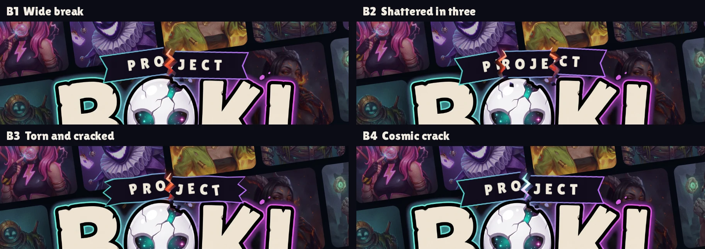
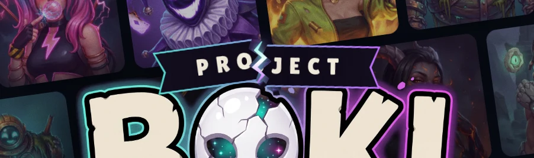

# The "PROJECT" plaque on the hero logo

Live: **B1**, a plaque cracked in two with an ember glow along each piece's broken edge (the broken kingdom). Built in HTML and CSS in
`index.html` (`.pj` inside `h1.lockup`) and `assets/style.css` (`.pj*`). BOKI itself is `assets/img/wordmark-boki-*.webp`;
the original `wordmark-*.webp` (with PROJECT baked in) is still used by the press kit.



## Saved alternative: B4, cosmic crack

The same break, but the gap glows with the egg's starlight (teal to white to purple) instead of ember, so it reads
as the egg's power breaking through.



To switch to B4, recolor the two broken-edge glows (`.pj-edge` in `assets/style.css`):

```css
.pj-edge .soft { fill: rgba(120, 220, 255, .35); }
.pj-edge .core { fill: #7ff5e6; }
```

Optionally tint the chips to match: `.pj-chip { filter: drop-shadow(0 0 4px rgba(120,220,255,.7)); }`.
